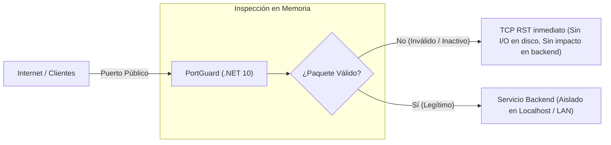

# 🛡️ PortGuard

> **Proxy Inverso y Firewall de Capa 7 (L7) de Alto Rendimiento para Servicios TCP**  
> Desarrollado en **.NET 10** y **C# 14** bajo los principios de **Clean Architecture**.

---

## 📌 1. ¿Qué es PortGuard y cuál es su finalidad?

Diversos servidores y servicios basados en sockets TCP legados o propietarios presentan una vulnerabilidad recurrente: **no fueron concebidos para mitigar ataques modernos de denegación de servicio (DoS/DDoS)** a nivel de transporte y aplicación.

Cuando agentes maliciosos o herramientas automatizadas de saturación generan miles de conexiones espurias por segundo (ataques de tipo *Junk Flood*, conexiones lentas *Slowloris* o paquetes deliberadamente malformados), los servidores destino colapsan al procesar datos inválidos, agotando sus descriptores de socket e incrementando el uso de CPU e I/O en disco por registro de errores.

**PortGuard actúa como un componente perimetral de control de admisión e inspección profunda:**

1. **Primera línea de contención:** Se sitúa como intermediario escuchando directamente en los puertos públicos accesibles desde redes externas o Internet.
2. **Inspección en memoria de alta eficiencia (Zero-Copy):** Al establecerse una conexión, PortGuard valida el paquete inicial en memoria sin generar operaciones en disco. Evalúa tiempos límite de respuesta (timeouts), rangos de longitud de carga útil y firmas de cabecera en bytes.
3. **Terminación inmediata de conexión (TCP RST):** Si el paquete no satisface las reglas de la política configurada, PortGuard interrumpe la conexión de forma inmediata emitiendo un flag `TCP RST` mediante configuración de sockets en el kernel (`LingerState = 0`). Esto evita el estado `TIME_WAIT` y preserva los recursos del servidor destino.
4. **Túnel bidireccional transparente (Duplex Stream):** Si la solicitud cumple estrictamente los criterios de validación, PortGuard inicia la conexión hacia el backend interno y enlaza ambos flujos de datos en tiempo real de manera transparente para el cliente y el servidor.



---

## ⚙️ 2. Guía de Configuración (`appsettings.json`)

El comportamiento operativo de PortGuard se define de manera declarativa a través del archivo `appsettings.json` (o `appsettings.Development.json`).

### 📄 Ejemplo con Múltiples Puertos y Políticas Concurrente

El sistema admite la configuración de un número arbitrario de puertos (`N`). Cada entrada dentro de la colección `PortPolicies` inicializa un escuchador TCP independiente y concurrente:

```json
{
  "Logging": {
    "LogLevel": {
      "Default": "Information",
      "Microsoft.Hosting.Lifetime": "Information"
    }
  },
  "PortGuardOptions": {
    "PortPolicies": [
      {
        "Name": "Servicio-Principal",
        "Port": 55999,
        "BackendInterface": "127.0.0.1",
        "BackendPort": 55998,
        "TimeoutMs": 1000,
        "MinPayloadLength": null,
        "MaxPayloadLength": null,
        "PayloadAllowedLengths": [4, 56],
        "HeaderPattern": "C1 38 29"
      },
      {
        "Name": "Servicio-Secundario",
        "Port": 44405,
        "BackendInterface": "127.0.0.1",
        "BackendPort": 44400,
        "TimeoutMs": 500,
        "MinPayloadLength": 3,
        "MaxPayloadLength": 64,
        "PayloadAllowedLengths": null,
        "HeaderPattern": null
      }
    ]
  }
}
```

---

### 🔍 Descripción de Parámetros

| Parámetro | Tipo | Obligatorio | Descripción |
| :--- | :---: | :---: | :--- |
| **`Name`** | `string` | **Sí** | Identificador descriptivo de la política para trazabilidad y registros del sistema (ej: `"Gateway-API"`, `"Core-Service"`). |
| **`Port`** | `int` | **Sí** | Puerto TCP público de escucha expuesto hacia los clientes (rango válido: `1` a `65535`). |
| **`BackendInterface`** | `string` | **Sí** | Dirección IP del host destino donde se reenviará el tráfico validado (ej: `"127.0.0.1"` o IP en red privada). Debe ser una IP en formato IPv4/IPv6 válido. |
| **`BackendPort`** | `int` | **Sí** | Puerto TCP interno donde reside el servicio backend protegido (rango válido: `1` a `65535`). |
| **`TimeoutMs`** | `int` | No *(def: 5000)* | Tiempo de espera máximo en milisegundos para recibir el primer paquete tras establecerse el handshake TCP. Al superarse, se cierra la conexión. |
| **`MinPayloadLength`** | `int?` | No | Longitud mínima en bytes aceptada para el paquete inicial (definición por rango). Utilizar `null` si no aplica. |
| **`MaxPayloadLength`** | `int?` | No | Longitud máxima en bytes aceptada para el paquete inicial (definición por rango). Utilizar `null` si no aplica. |
| **`PayloadAllowedLengths`**| `int[]?`| No | Lista de longitudes exactas permitidas en bytes (ej: `[4, 56]`). Si se define, el paquete debe coincidir con uno de los valores especificados. |
| **`HeaderPattern`** | `string?`| No | Patrón en formato hexadecimal que debe coincidir con los primeros bytes del paquete (ej: `"C1 38 29"` o `"C13829"`). |

---

### 📋 Criterios y Restricciones de Configuración

#### Acciones Permitidas:
- **Escucha múltiple concurrente:** Se pueden definir múltiples bloques de políticas dentro de `PortPolicies`. Cada puerto opera con su propio ciclo de vida e hilo de ejecución.
- **Validaciones optativas e independientes:** Las reglas de longitud (`MinPayloadLength`, `MaxPayloadLength`, `PayloadAllowedLengths`) y de cabecera (`HeaderPattern`) pueden dejarse en `null` de forma individual si no se requiere su aplicación en un servicio particular.
- **Flexibilidad en formato hexadecimal:** El parámetro `HeaderPattern` acepta cadenas con o sin delimitación por espacios (por ejemplo, `"C1 38 29"` equivale a `"C13829"`).

#### Restricciones a Considerar:
- **Unicidad de puertos de escucha:** Dos políticas no pueden utilizar el mismo valor en `Port`.
- **Diferenciación de puertos entre Gateway y Backend:** Si PortGuard y el servicio backend residen en el mismo host físico o virtual, no pueden compartir el mismo número de puerto en la misma interfaz de red. El puerto público debe pertenecer a PortGuard y el servicio backend debe reubicarse en un puerto interno (por ejemplo: PortGuard en `55999`, Backend en `55998`).
- **Validez de tipos de datos:** Los nombres de las claves deben respetar la nomenclatura indicada. Valores vacíos en campos numéricos deben definirse explícitamente como `null` o excluirse si son opcionales.
- **Direccionamiento numérico:** `BackendInterface` requiere una dirección IP explícita (como `"127.0.0.1"`). No se deben utilizar nombres de resolución DNS como `"localhost"`.

---

## 🚀 3. Compilación y Ejecución

### Requisitos
- **.NET 10 SDK** (o versión superior compatible).

### Compilación del Proyecto
Desde el directorio raíz de la solución:
```bash
dotnet build
```

### Ejecución en Modo Consola (Entorno de Desarrollo)
Para ejecutar la aplicación en primer plano con salida de registros en la terminal:
```bash
dotnet run --project src/PortGuard.Workers
```

---

## 🖥️ 4. Despliegue como Servicio del Sistema Operativo

PortGuard está preparado para ejecutarse como un servicio en segundo plano con inicio automático tanto en entornos **Windows Server** como en distribuciones **Linux**.

### Opción A: Despliegue en Windows Server (Servicio de Windows)

1. **Generar la publicación binaria:**
   ```powershell
   dotnet publish src/PortGuard.Workers/PortGuard.Workers.csproj -c Release -o C:\PortGuard
   ```

2. **Registrar el servicio del sistema (ejecutar PowerShell con privilegios elevados de Administrador):**
   ```powershell
   sc.exe create "PortGuard" binPath= "C:\PortGuard\PortGuard.Workers.exe" start= auto
   ```

3. **Iniciar el servicio:**
   ```powershell
   sc.exe start "PortGuard"
   ```
   *(También es posible administrarlo desde la consola gráfica `services.msc`, localizando el servicio **PortGuard**).*

4. **Detención y remoción del servicio:**
   ```powershell
   sc.exe stop "PortGuard"
   sc.exe delete "PortGuard"
   ```

---

### Opción B: Despliegue en Linux (Demonio `systemd`)

1. **Publicar el ejecutable autónomo para Linux:**
   ```bash
   dotnet publish src/PortGuard.Workers/PortGuard.Workers.csproj -c Release -r linux-x64 --self-contained -o /opt/portguard
   chmod +x /opt/portguard/PortGuard.Workers
   ```

2. **Crear la definición de la unidad de servicio:**  
   Crear el archivo `/etc/systemd/system/portguard.service` con la siguiente estructura:
   ```ini
   [Unit]
   Description=PortGuard L7 Reverse Proxy and Gatekeeper
   After=network.target

   [Service]
   Type=notify
   ExecStart=/opt/portguard/PortGuard.Workers
   WorkingDirectory=/opt/portguard
   Restart=always
   RestartSec=5
   KillMode=process

   [Install]
   WantedBy=multi-user.target
   ```

3. **Habilitar e iniciar la unidad:**
   ```bash
   sudo systemctl daemon-reload
   sudo systemctl enable --now portguard
   ```

4. **Monitoreo y consulta de registros:**
   ```bash
   sudo systemctl status portguard
   sudo journalctl -u portguard -f
   ```

---

## 🔒 5. Configuración de Red y Seguridad perimetral

Para garantizar el aislamiento adecuado de la infraestructura:

1. **Puerto público de PortGuard (ej: 55999):** Debe configurarse en el Firewall del sistema operativo para permitir tráfico entrante desde cualquier dirección IP externa (`0.0.0.0/0`).
2. **Puerto del backend interno (ej: 55998):** Debe enlazarse exclusivamente a la interfaz local de bucle invertido (`127.0.0.1`) o restringirse en el firewall del host para rechazar cualquier paquete que no provenga del adaptador local.

Con este esquema, los intentos de acceso externo dirigidos directamente al puerto privado son descartados por el stack de red del sistema operativo, garantizando que el único punto de entrada sea la inspección de PortGuard.

---

## 🧱 6. Arquitectura del Proyecto (Clean Architecture)

```text
PortGuard/
├── src/
│   ├── PortGuard.Application/       # Capa de Dominio y Casos de Uso: Abstracciones, Pipelines de validación y Orquestador
│   ├── PortGuard.Infrastructure/    # Capa de Infraestructura: Manejo de Sockets, Descarte TCP RST y Túnel dúplex
│   └── PortGuard.Workers/           # Capa de Entrada / Hosting: BackgroundService y configuración de servicios del SO
├── PortGuard.slnx                   # Solución .NET
└── README.md                        # Documentación técnica
```
